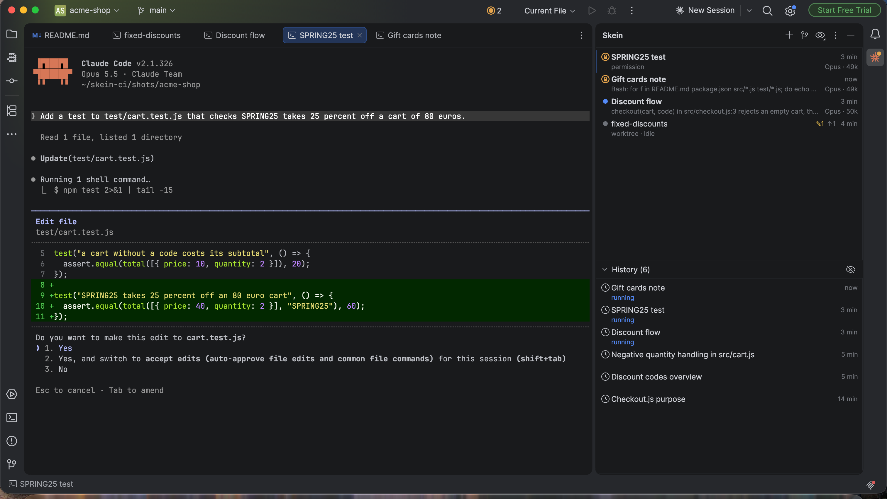
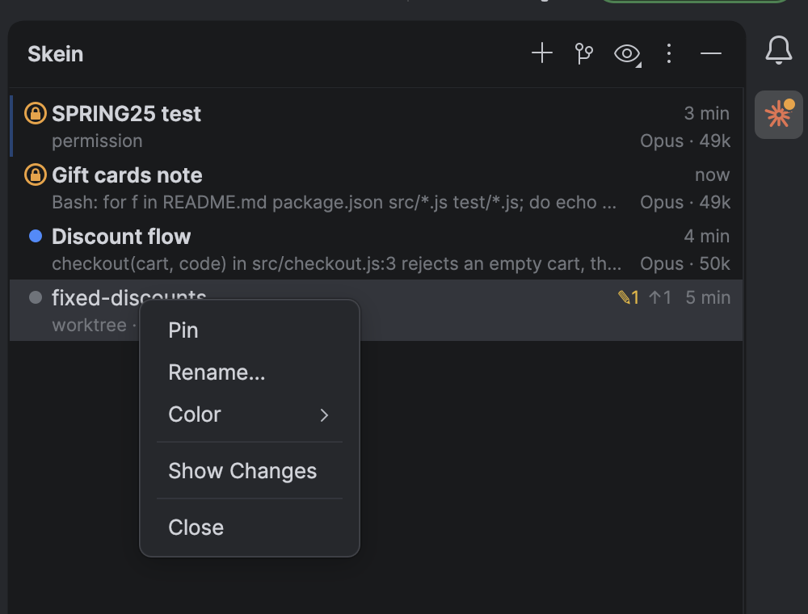
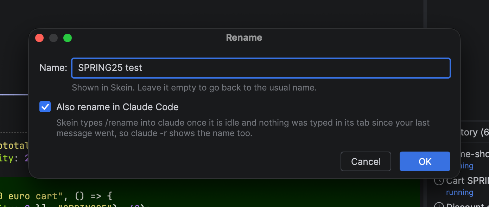
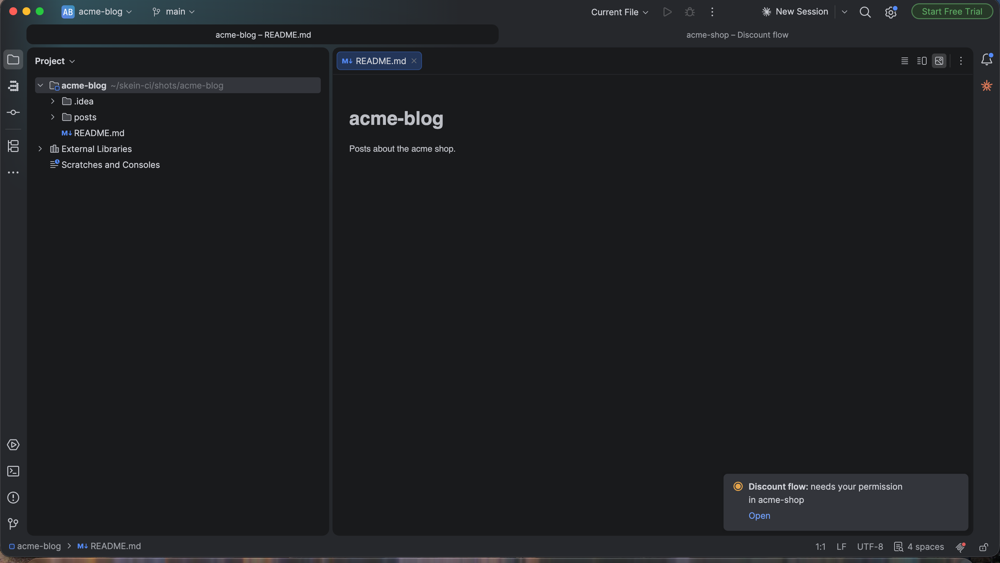
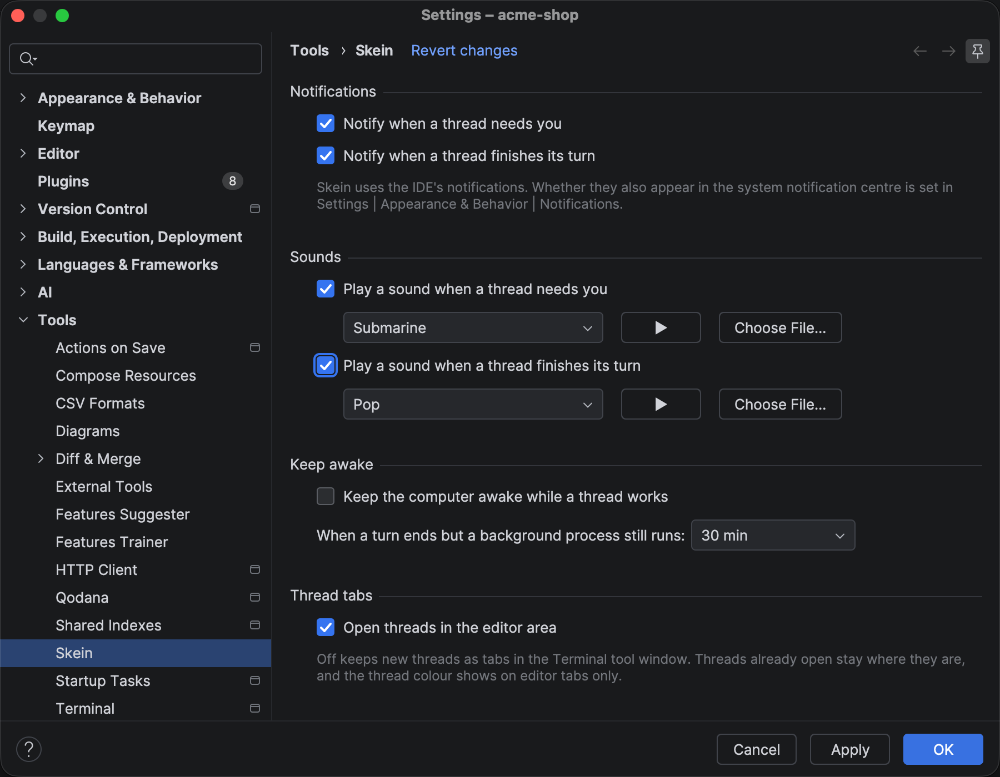
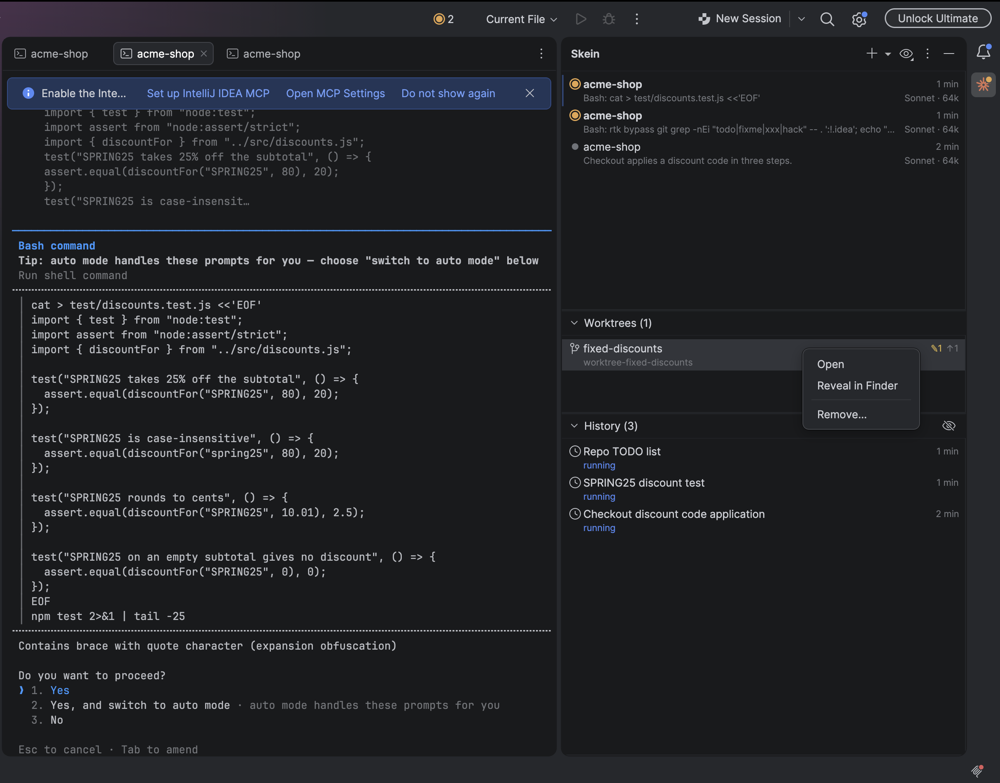

# Skein

Skein keeps your Claude Code CLI sessions as threads next to your code in IntelliJ-based IDEs. A side panel lists the
project's sessions, shows which one waits for you and notifies you when one stops, so a session never sits forgotten
on a permission prompt.

Unofficial, for Claude Code, not affiliated with Anthropic.

## Why Skein

- Your own `claude`, untouched. Each thread is an ordinary IDE terminal tab running the Claude Code CLI you already
  use, so your subscription, settings, slash commands, MCP servers and hooks work exactly as in your terminal. There
  is no chat panel that re-implements Claude Code and no API key to paste.
- Nothing installed into Claude Code. Skein adds no hook and no setting and writes nothing into your Claude home; it
  learns what each session does from Claude Code's own session files, and from `.claude.json` only whether a folder is
  trusted.
- No session waits unseen. Every thread shows whether it waits for you, finished its turn or still works, and Skein
  counts the threads waiting for you and notifies you in the project window you are looking at, even when the thread
  lives in another one, with the sound you picked for that kind of event.
- Every session of the project in one place. The History lists them by your name for them or Claude Code's title,
  picks up the ones you went on with in a plain terminal, and you resume, pin, rename or mark them done - a rename can
  go to Claude Code too, so `claude -r` shows it as well.
- The model and the context in use on every thread's row.
- Parallel work in git worktrees. A worktree thread runs `claude --worktree`, its row counts changed files and commits
  not yet merged, and a kept worktree can be opened again or removed safely - Skein never forces a remove without a
  second question and never deletes an unmerged branch.
- Clean exits. Closing a thread's tab ends claude and its shell, so no session keeps running behind a closed tab.
- Free and open source under Apache 2.0, with no telemetry: Skein sends nothing over the network.

## Requirements

An IntelliJ-based IDE 2026.3 or newer with the bundled terminal plugin, on local macOS, Windows or Linux, and Claude
Code 2.1.162 or newer on your PATH. On Windows Claude Code's installer puts `claude.exe` in `%USERPROFILE%\.local\bin`
without adding that folder to PATH - add it and restart the IDE, and Skein says so when it finds claude only there.
For projects opened through WSL and in Remote Development Skein turns itself off and the tool window says why.

## Installing

From the JetBrains Marketplace once Skein is listed there: Settings | Plugins | Marketplace, search for Skein. Until
then, or for a specific version, download `skein-intellij-<version>.zip` from the
[releases](https://github.com/v0rest/skein-intellij-claude-code/releases) and install it as it is, without unpacking,
through Settings | Plugins | ⚙ | Install Plugin from Disk. Installing, updating, turning off or removing Skein asks for a
restart of the IDE, since the native libraries it loads cannot be unloaded while the IDE runs.

## Using it

"+" in the Skein tool window starts a thread in the project folder, and the branch button next to it starts New Thread
in Worktree…. New Thread Here in the right-click menu of a folder or a file in the Project view, or of an editor tab,
starts one in that folder, or in the file's folder.
A thread opens as an editor tab, or as a tab in the Terminal tool window if you turn off Open threads in the
editor area in Settings | Tools | Skein, and you can drag its tab between the two. A thread turns orange when it waits
for you, with a lock for a permission prompt and a speech bubble for a question, and blue when it finished and you
have not looked yet. A click opens its tab, and Tools | Skein | Jump to Waiting Thread does the same from the
keyboard. The eye in the title bar filters and groups the threads, a right click
on a thread pins, renames, colours or closes it, and a double click on a History session resumes it in a new tab.

Rename… names a thread or a History session in Skein, and with Also rename in Claude Code ticked Skein types
`/rename` into its claude too, once claude is idle and nothing was typed in its tab since your last message.

When a thread needs you while another project's window or tab is in front, its balloon shows there and says which
project the thread is in, and Open takes you to it. Settings | Tools | Skein has a switch and a sound for each kind of
event: the system beep, one of your system's own alert sounds or a file of your own.

Worktrees (N) lists the worktrees Claude Code left in `.claude/worktrees` that no thread holds, with the same counts,
and opens, reveals or removes them. Show Changes, in the right-click menu of a worktree thread or of a kept worktree,
opens the IDE's diff window on everything the worktree changed since it branched off its base, committed or not.

Everything else, from how Skein matches a session to its tab to what a worktree remove checks first, what is tested
and how releases are made, is in [docs/details.md](docs/details.md).

## Contributing

Issues and pull requests are welcome. The workflows of a pull request from outside the repository run only after the
maintainer approves them, with a read-only token and no secrets. Report a vulnerability privately, as SECURITY.md
describes, not in an issue.

## Building

`./gradlew buildPlugin` builds `build/distributions/skein-intellij-<version>.zip`, `./gradlew test verifyPlugin`
runs the tests and the verifier (with `-PverifyNewestIdes=true` against the newest IDEs instead of 2026.3), and
`./gradlew runIde` starts a sandbox IDE with the plugin. `tools/fake-claude` holds a fake `claude` for the end-to-end
tests, which also drives a sandbox IDE without a Claude Code login, as its README describes.

## License

Apache License 2.0.
