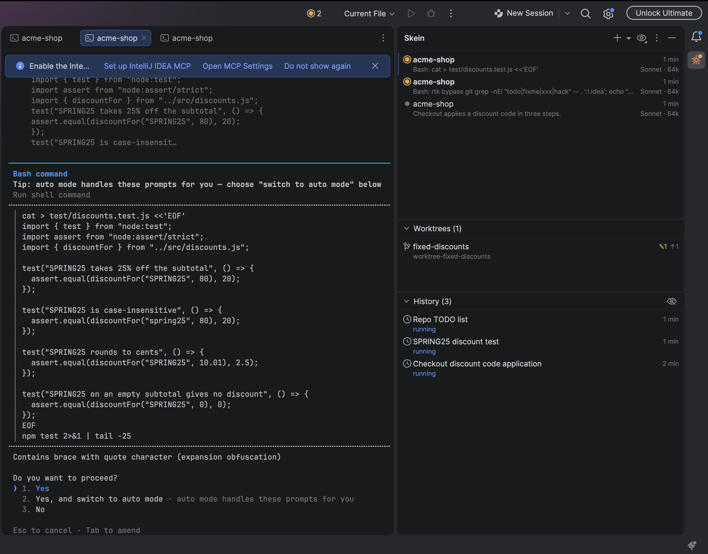
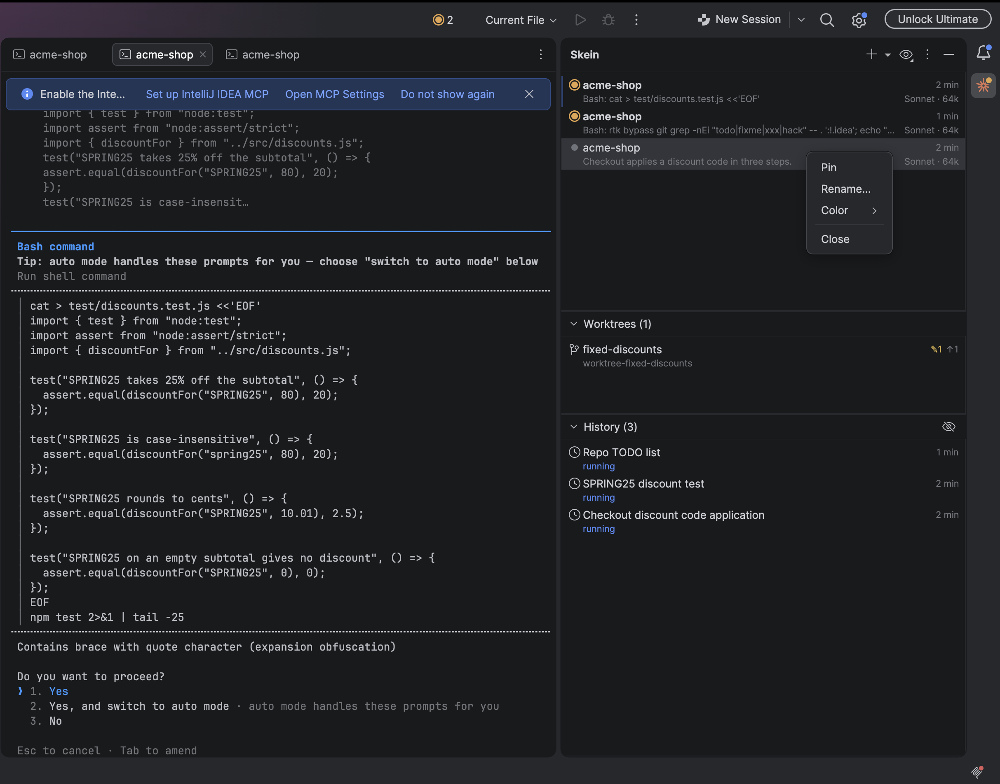
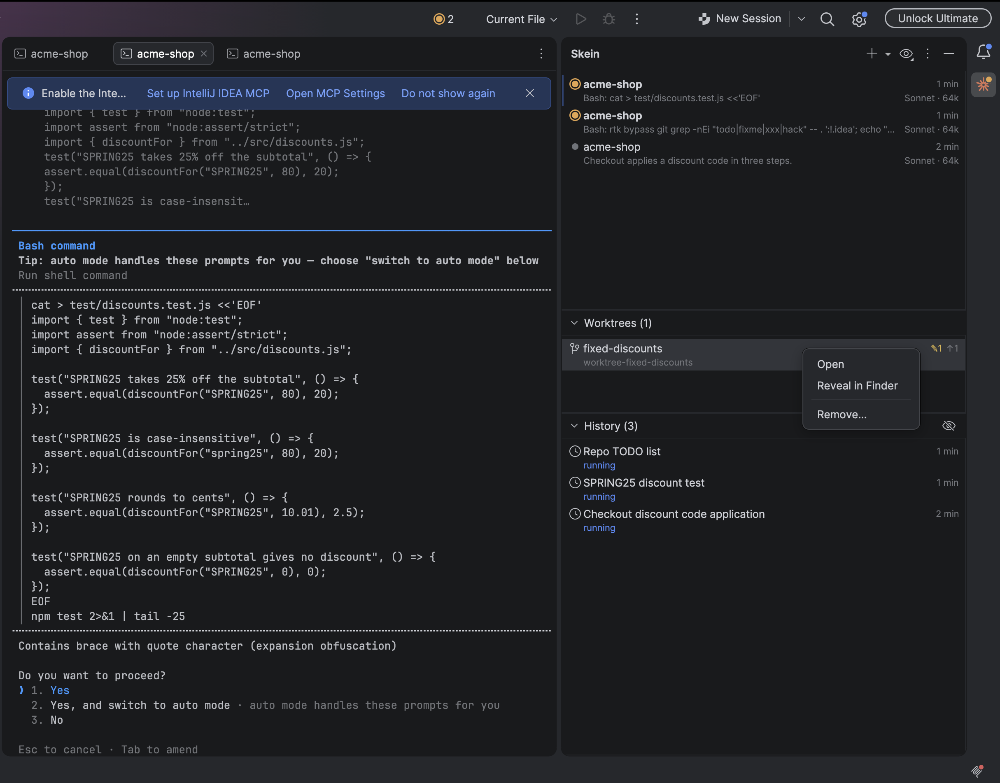

# Skein

Skein keeps your Claude Code CLI sessions as threads next to your code in IntelliJ-based IDEs. A side panel lists the
project's sessions, shows which one waits for you and notifies you when one stops, so a session never sits forgotten
on a permission prompt.

Unofficial, for Claude Code, not affiliated with Anthropic.

## Why Skein

- Your own `claude`, untouched. Each thread is an ordinary IDE terminal tab running the Claude Code CLI you already
  use, so your subscription, settings, slash commands, MCP servers and hooks work exactly as in your terminal. There
  is no chat panel that re-implements Claude Code and no API key to paste.
- Nothing installed into Claude Code. Skein adds no hook and no setting and writes nothing into your Claude home; it
  learns what each session does from Claude Code's own session files.
- No session waits unseen. Every thread shows whether it waits for you, finished its turn or still works, and Skein
  notifies you, plays a sound if you like and counts the threads waiting for you.
- Every session of the project in one place. The History lists them by your name for them or Claude Code's title, and
  you resume, pin, rename or mark them done.
- The model and the context in use on every thread's row.
- Parallel work in git worktrees. A worktree thread runs `claude --worktree`, its row counts changed files and commits
  not yet merged, and a kept worktree can be opened again or removed safely - Skein never forces a remove without a
  second question and never deletes an unmerged branch.
- Clean exits. Closing a thread's tab ends claude and its shell, so no session keeps running behind a closed tab.
- Free and open source under Apache 2.0, with no telemetry: Skein sends nothing over the network.

## Requirements

An IntelliJ-based IDE 2026.3 or newer with the bundled terminal plugin, on local macOS or Linux, and Claude Code
2.1.162 or newer on your PATH. On native Windows, for projects opened through WSL and in Remote Development Skein
turns itself off and the tool window says why.

## Installing

From the JetBrains Marketplace once Skein is listed there: Settings | Plugins | Marketplace, search for Skein. Until
then, or for a specific version, download `skein-intellij-<version>.zip` from the
[releases](https://github.com/v0rest/skein-intellij-claude-code/releases) and install it as it is, without unpacking,
through Settings | Plugins | ⚙ | Install Plugin from Disk.

## Using it

"+" in the Skein tool window starts a thread in the project folder, and the chevron next to it offers New Thread in
Worktree…. New Thread Here in the right-click menu of a folder or a file in the Project view, or of an editor tab,
starts one in that folder, or in the file's folder.
A thread opens as an editor tab, or as a tab in the Terminal tool window if you turn off Open threads in the
editor area in Settings | Tools | Skein, and you can drag its tab between the two. A thread turns orange when it waits
for you and blue when it finished and you have not looked yet; a click opens its tab, and Tools | Skein | Jump to
Waiting Thread does the same from the keyboard. The eye in the title bar filters and groups the threads, a right click
on a thread pins, renames, colours or closes it, and a double click on a History session resumes it in a new tab.

Worktrees (N) lists the worktrees Claude Code left in `.claude/worktrees` that no thread holds, with the same counts,
and opens, reveals or removes them.

Everything else, from how Skein matches a session to its tab to what a worktree remove checks first, what is tested
and how releases are made, is in [docs/details.md](docs/details.md).

## Contributing

Issues and pull requests are welcome. The workflows of a pull request from outside the repository run only after the
maintainer approves them, with a read-only token and no secrets. Report a vulnerability privately, as SECURITY.md
describes, not in an issue.

## Building

`./gradlew buildPlugin` builds `build/distributions/skein-intellij-<version>.zip`, `./gradlew test verifyPlugin`
runs the tests and the verifier (with `-PverifyNewestIdes=true` against the newest IDEs instead of 2026.3), and
`./gradlew runIde` starts a sandbox IDE with the plugin.

## License

Apache License 2.0.
